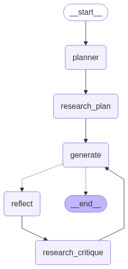

Let's add a .env file with the following keys:

OPENAI_API_KEY=
GOOGLE_API_KEY=
TAVILY_API_KEY=

And the run it in an virtual environment installing all requirements

Here it's the graph that the code is implementing 

